# Användarmanual: fakturering

För dig som skapar fakturor, sköter inställningar och ROT, eller granskar bokföringen. Manualen följer arbetsgången från första inloggning till export för revisorn. Du behöver inga förkunskaper i ekonomi; ord som *OCR*, *kreditfaktura* och *verifikation* förklaras där de dyker upp.

Skärmbilderna är tagna i testorganisationen **Testbolag AB** med påhittade kunder (Rättelseprov Andersson, Mottagarprov Torki). Era egna sidor ser likadana ut men med Binaafys uppgifter.

**Vem läser vad**

| Du är | Läs särskilt |
|---|---|
| Personal som fakturerar | 1, 3, 4, 5, 6, 7, 8, 9 och Vanliga frågor |
| Ägare eller administratör | Allt, särskilt 2 (Inställningar), 10 (ROT), 13 (Ekonomi) och 14 (Organisation) |
| Revisor eller redovisningskonsult | 1, 9, 13 och Vanliga frågor |

**Innehåll**

1. [Komma igång](#1-komma-igång)
2. [Inställningar](#2-inställningar)
3. [Kunder](#3-kunder)
4. [Skapa en faktura](#4-skapa-en-faktura)
5. [Granska och utfärda](#5-granska-och-utfärda)
6. [Skicka](#6-skicka)
7. [Betalningar](#7-betalningar)
8. [Påminnelser och ränta](#8-påminnelser-och-ränta)
9. [Rätta fel](#9-rätta-fel)
10. [ROT](#10-rot)
11. [Återkommande fakturor](#11-återkommande-fakturor)
12. [Byggprojekt och betalplaner](#12-byggprojekt-och-betalplaner)
13. [Ekonomi och bokföring](#13-ekonomi-och-bokföring)
14. [Organisation och API](#14-organisation-och-api)
15. [Kundportalen och kundens vy](#15-kundportalen-och-kundens-vy)
16. [Vanliga frågor](#16-vanliga-frågor)

---

## 1. Komma igång

*Syfte: hitta rätt i admin och veta vilket företag och vilken roll du arbetar med.*

### Logga in

1. Gå till **binaafy.se/admin** (under utveckling `localhost:3000/admin`).
2. Logga in med din **e-post** och ditt **lösenord**. Är du nyss inbjuden, använd länken i inbjudan första gången (se kapitel 14).
3. Klicka på **Idag** (eller logotypen) för att se det som väntar på dig: nya förfrågningar, försenade faser och förfallna fakturor.

### Menyn

Menyn högst upp har **Idag**, **Inkorg** (förfrågningar från webbplatsen), **Offerter**, **Projekt**, **Fakturor** och **Ekonomi**. Under **Ekonomi** finns Översikt, Kunder, ROT och RUT, Återkommande fakturor, Bankfil samt Export och bokföring. Den orange knappen **+ Ny** skapar snabbt en offert, ett projekt, en faktura eller en kund.

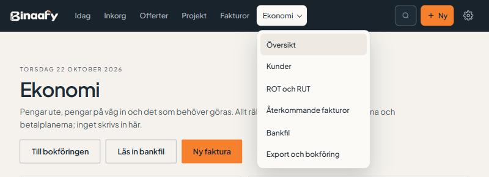

### Organisationsväxlaren

Kugghjulet längst till höger öppnar **Inställningar och konto**. Där står vilket företag du arbetar i och din roll, och rullistan byter företag om du är medlem i flera (till exempel Binaafy AB och Testbolag AB). Där finns också Inställningar, Organisation och roller, API och Logga ut.

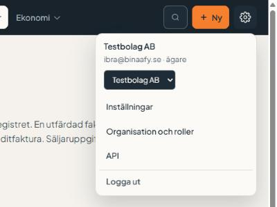

1. Klicka på kugghjulet.
2. Välj företag i rullistan. Sidan laddas om och visar det företagets ekonomi.
3. Kontrollera namnet överst i menyn innan du skapar något.

> **Tänk på:** Allt du gör hamnar i det företag som är valt. En faktura som utfärdas i fel företag får ett nummer i det företagets serie och kan inte flyttas. Testa nya saker i Testbolag AB, aldrig i Binaafy AB.

### Roller

Varje person har en roll per företag. Rollen styr vad hen ser och får göra.

| Roll | Får göra |
|---|---|
| Ägare | Allt, även ändra ägare och organisationen |
| Administratör | Allt utom ägarfrågor: inställningar, medlemmar, API-nycklar |
| Personal | Fakturor, kunder, betalningar, projekt |
| Redovisningskonsult | Läser ekonomi, fakturor och bokföring, laddar ner SIE. Skriver inget |
| Läsbehörighet | Läser ekonomi och fakturor |

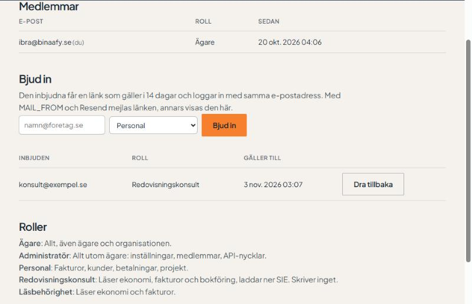

---

## 2. Inställningar

*Syfte: ange en gång det som ska stå på varje faktura och styra påminnelser och bokföring.* Sidan nås via kugghjulet › **Inställningar**. Den sköts av ägaren eller en administratör.

1. Fyll i varje avsnitt (beskrivs nedan).
2. Klicka **Spara inställningarna** i den mörka listen längst ner. Listen visar "Inga osparade ändringar" när allt är sparat.
3. Nya fakturor använder de nya uppgifterna. Redan utfärdade fakturor behåller det som gällde när de utfärdades.

### Företaget på fakturan

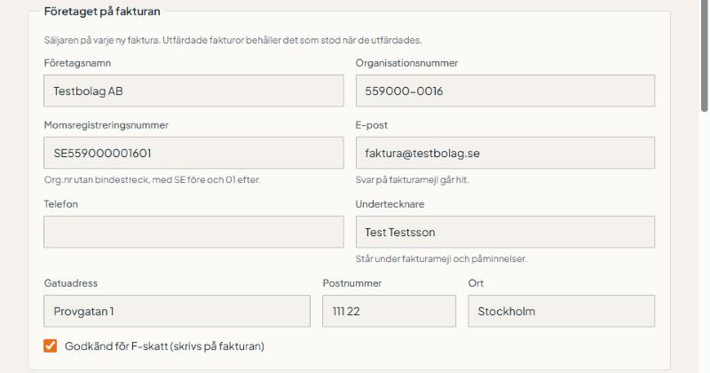

| Fält | Betyder | Hamnar på fakturan |
|---|---|---|
| Företagsnamn | Det juridiska namnet, t.ex. Binaafy AB | Överst till vänster, i sidfoten och som avsändare i mejlet |
| Organisationsnummer | 10 siffror med bindestreck | Sidfoten |
| Momsregistreringsnummer | SE + organisationsnumret utan bindestreck + 01 | Sidfoten; krävs vid omvänd moms |
| E-post | Svar på fakturamejl går hit | Sidfoten och "Frågor:" på den publika sidan |
| Telefon | Valfritt | Sidfoten |
| Undertecknare | Namnet som står under mejl och påminnelser | Mejlet; "Vår referens" om inget annat anges |
| Gatuadress, postnummer, ort | Företagets adress | Avsändarraden; orten blir "säte" i sidfoten |
| Godkänd för F-skatt | Bocka i om företaget har F-skatt | Texten "Godkänd för F-skatt" i sidfoten |

### Betalning

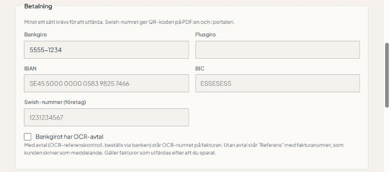

| Fält | Betyder | Hamnar på fakturan |
|---|---|---|
| Bankgiro | Företagets bankgironummer | Betalningsrutan längst ner |
| Plusgiro, IBAN, BIC | Valfria; IBAN/BIC behövs för betalning från utlandet | Betalningsrutan |
| Swish-nummer (företag) | Swish Företag-numret, 123 xxx xx xx | Ger **Swish-QR-koden** på PDF:en, i portalen och på den publika sidan |
| Bankgirot har OCR-avtal | Bocka i bara om banken har aktiverat OCR-referenskontroll på bankgirot | Med avtal står **OCR-nummer** på fakturan; utan står **Referens** med fakturanumret som kunden skriver som meddelande |

Minst ett betalsätt krävs för att kunna utfärda.

> **Tänk på:** Bocka inte i "OCR-avtal" förrän banken bekräftat avtalet. Utan avtal kan banken avvisa eller tappa OCR-numret och betalningen blir svår att matcha. Ändringen gäller bara fakturor som utfärdas efteråt.

### Villkor

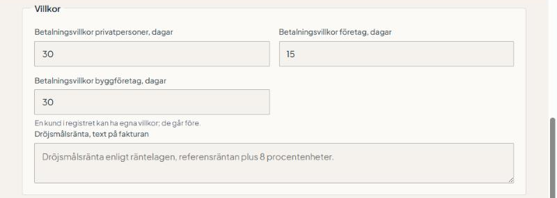

- **Betalningsvillkor, dagar**, separat för privatpersoner, företag och byggföretag. Förfallodagen räknas ut från fakturadatum plus antal dagar. En kund kan ha egna villkor i kundregistret; de går före.
- **Dröjsmålsränta, text på fakturan**: texten som står längst ner, normalt "Dröjsmålsränta enligt räntelagen, referensräntan plus 8 procentenheter."

### Påminnelser och bokföring

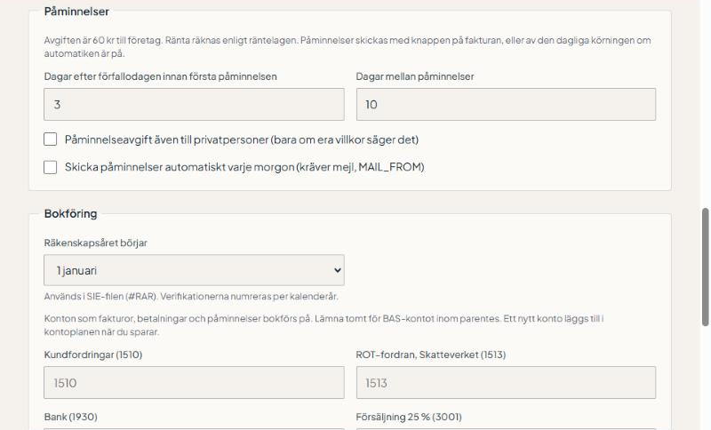

- **Dagar efter förfallodagen innan första påminnelsen** och **Dagar mellan påminnelser**.
- **Påminnelseavgift även till privatpersoner**: bocka bara i om era avtalsvillkor med kunden säger att avgift tas ut. Annars tas avgift (60 kr) bara från företag.
- **Skicka påminnelser automatiskt varje morgon**: av som standard. När det är av skickar ni påminnelser själva med knappen på fakturan (se kapitel 8).
- **Räkenskapsåret börjar**: används i SIE-filen.
- **Konton**: vilka konton i kontoplanen fakturor, betalningar och påminnelser bokförs på. Lämna tomt för BAS-kontot inom parentes; ändra bara i samråd med redovisningskonsulten.

### Nummerserier

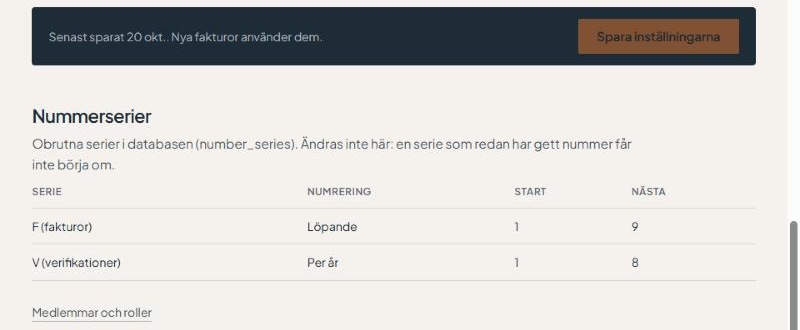

Längst ner visas serierna: **F** för fakturor (löpande, 1, 2, 3 …) och **V** för verifikationer (bokföringsposter, börjar om varje år). Serierna är obrutna: varje nummer används en gång och inget hoppas över. De kan inte ändras här, eftersom en serie som redan gett nummer aldrig får börja om.

---

## 3. Kunder

*Syfte: lägga upp kunden en gång så att moms, ROT och mottagare blir rätt på varje faktura.* Sidan nås via **Ekonomi › Kunder** eller knappen **Kunder** på fakturalistan.

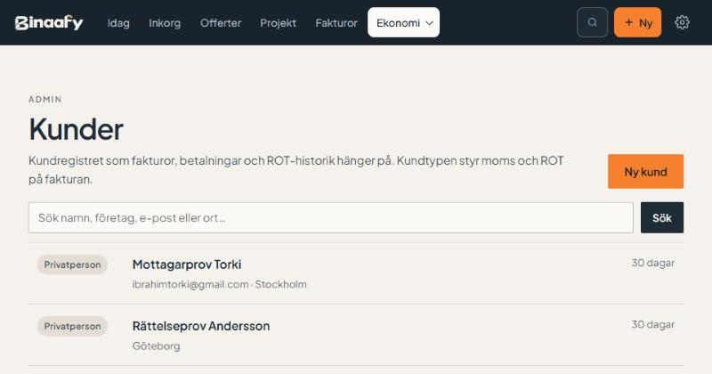

### Ny kund

1. Klicka **Ny kund**.
2. Välj **kundtyp** (se tabellen nedan). Formuläret ändras efter typen.
3. Fyll i namn, e-post och adress. För företag och byggföretag även organisationsnummer.
4. Ange vid behov egna **Betalningsvillkor, dagar** och interna anteckningar.
5. Klicka **Skapa kunden**.

| Kundtyp | Priser | Moms | ROT |
|---|---|---|---|
| **Privatperson** | Visas inklusive moms | Vanlig moms | Kan dras på arbete |
| **Företag** | Visas exklusive moms med momsrad | Vanlig moms | Nej |
| **Byggföretag** | Exklusive moms | **Omvänd betalningsskyldighet**: ingen moms på fakturan, köparen redovisar momsen. Texten "Omvänd betalningsskyldighet" skrivs ut | Nej |

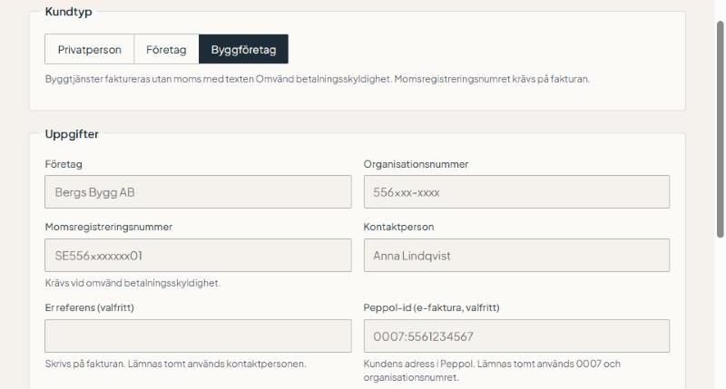

Byggföretag gäller när ni säljer byggtjänster till ett annat företag i byggbranschen, till exempel som underentreprenör. Då krävs köparens **momsregistreringsnummer**. Fältet **Peppol-id** behövs bara om kunden vill ha e-faktura.

### Flera e-postmottagare

En kund kan ha flera fakturamottagare och kopiemottagare.

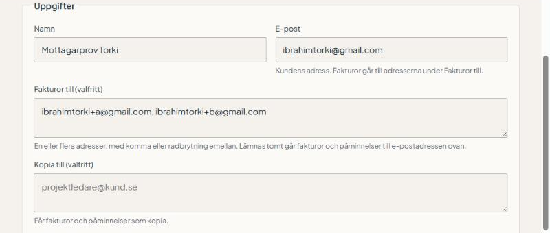

- **E-post**: kundens vanliga adress.
- **Fakturor till (valfritt)**: en eller flera adresser, med komma eller radbrytning emellan (högst tio). Lämnas fältet tomt går fakturor och påminnelser till e-postadressen ovan.
- **Kopia till (valfritt)**: får fakturor och påminnelser som kopia, till exempel en projektledare.

> **Tänk på:** Mottagarna "fryses" på fakturan när den utfärdas. Ändrar du kundens adresser efteråt går senare utskick och påminnelser för gamla fakturor fortfarande till de adresser som gällde då. Behöver en enstaka faktura gå till någon annan, skriv adressen i fältet *Fler mottagare för just den här fakturan* när du skickar.

---

## 4. Skapa en faktura

*Syfte: få fram ett utkast med rätt kund, rader och ROT.* Ett **utkast** går att ändra fritt och har inget nummer än.

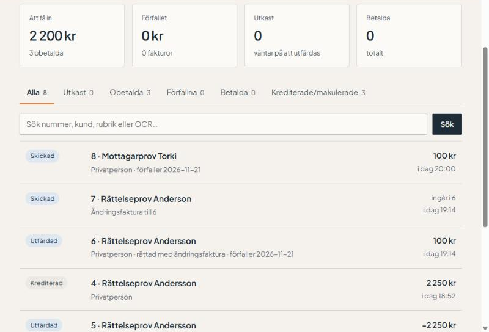

Fakturalistan (**Fakturor**) visar *Att få in*, *Förfallet*, antal utkast och betalda, och flikarna Alla, Utkast, Obetalda, Förfallna, Betalda och Krediterade/makulerade. Sökrutan söker på nummer, kund, rubrik eller OCR.

Det finns tre sätt att skapa en faktura.

### A. Från en kund

1. Klicka **Ny faktura** (eller **+ Ny › Faktura**).
2. Välj kund i listan under *För en kund i registret*. Saknas kunden: **Lägg till kund**.
3. Klicka **Skapa tomt utkast**.

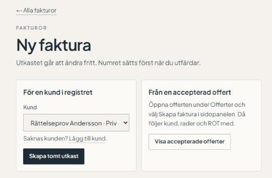

### B. Från en accepterad offert

1. Öppna offerten under **Offerter**.
2. Klicka **Skapa faktura från offerten** i sidopanelen (*Fakturera*). Knappen finns när offerten är accepterad.
3. Ett utkast öppnas med kund, rader, ROT-personer och villkor från offerten.

### C. Från en betalplan

Har projektet en betalplan skapas delfakturorna från projektet med **Skapa faktura** på det steg som kan faktureras. Se kapitel 12.

### Fyll i utkastet

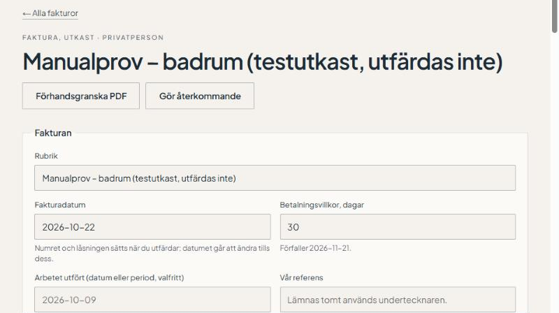

1. **Rubrik**: vad fakturan gäller, t.ex. "Badrumsrenovering, Bräckevägen 12".
2. **Fakturadatum** (i dag som standard) och **Betalningsvillkor, dagar**. Förfallodagen visas under fältet.
3. **Arbetet utfört**: datum eller period, om det skiljer sig från fakturadatumet (momslagen kräver det).
4. **Vår referens**, **Ert ordernummer** och **Text under rubriken** (t.ex. vilken offert och vilket steg fakturan avser).
5. Kontrollera kundens namn, e-post och adress under *Kund*. Ändringar här gäller bara den här fakturan.

### Rader och enheter

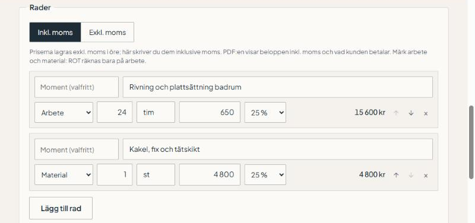

1. Klicka **Lägg till rad** för varje post.
2. Skriv vad som ingår ("Rivning och plattsättning badrum"). **Moment** är en valfri rubrik som grupperar rader.
3. Välj **typ**: *Arbete*, *Material* eller *Övrigt*. Det avgör ROT, som bara räknas på arbete.
4. Skriv **antal** och **enhet**: *tim* för timmar, *st* för styck, *m²*, *lpm* (löpmeter) och så vidare. Timmar i enheten *tim* används också i ROT-begäran till Skatteverket.
5. Skriv **à-pris** (pris per enhet). Knappen *Inkl. moms / Exkl. moms* växlar hur du skriver priset; systemet räknar om.
6. Välj **moms**: 25 % för nästan allt bygg, 12 % eller 6 % i specialfall, *Momsfri* bara när det verkligen gäller.
7. Pilarna flyttar raden, × tar bort den.

### ROT-fälten

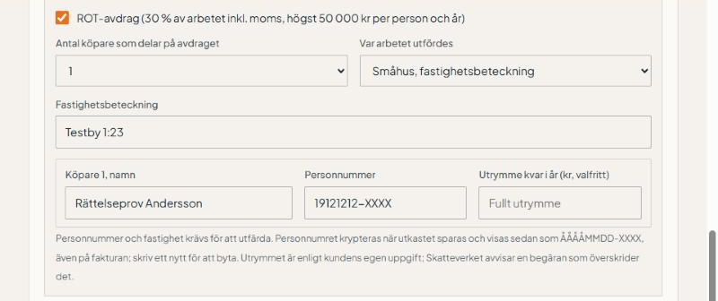

ROT gäller privatpersoner och arbete i bostaden. 2026 är avdraget 30 % av arbetskostnaden inklusive moms, högst 50 000 kr per person och år.

1. Bocka i **ROT-avdrag**.
2. Välj **antal köpare** som delar på avdraget (t.ex. två makar som äger huset tillsammans).
3. Välj **var arbetet utfördes**: *Småhus* (fyll i **fastighetsbeteckning**, t.ex. "Göteborg Bräcke 1:23") eller *Bostadsrätt* (föreningens organisationsnummer och lägenhetsnummer).
4. Fyll i varje köpares **namn** och **personnummer**. *Utrymme kvar i år* är valfritt och enligt kundens egen uppgift.
5. Klicka **Spara utkastet**. Summan visar Arbete, Material, moms, ROT-avdrag och *Att betala*.

> **Tänk på:** Personnumret krypteras när utkastet sparas och visas sedan som ÅÅÅÅMMDD-XXXX, även på fakturan. Vill du byta det, skriv ett helt nytt. Fakturan kan inte utfärdas utan personnummer och fastighet. Om kundens utrymme inte räcker avvisar Skatteverket begäran och kunden får betala resten.

Längst ner finns **Förhandsgranska PDF** (överst på sidan), **Gör återkommande**, **Spara utkastet** och **Ta bort utkastet**. Ett utkast som inte ska användas kan tas bort; det har inget nummer och lämnar inga spår i bokföringen.

---

## 5. Granska och utfärda

*Syfte: låsa fakturan, ge den ett nummer och bokföra den.* Först när fakturan är **utfärdad** är den en riktig faktura.

1. Spara utkastet.
2. Klicka **Utfärda fakturan…** i rutan *Utfärda* (under redigeraren). Står det något i rutan som saknas, till exempel en rad eller ett personnummer, rätta det först.
3. Granskningsfönstret visar PDF:en till vänster och en sammanfattning till höger: kund, att betala, förfallodag, ROT, omvänd moms och antal rader. Läs PDF:en från början till slut.
4. Stämmer allt: klicka **Utfärda nu**. Annars **Tillbaka**, ändra och spara.

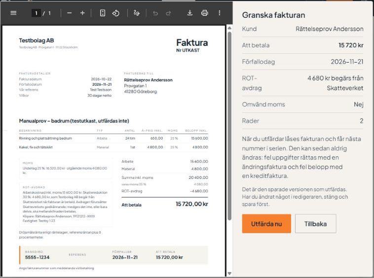

### Vad som händer när du utfärdar

- Fakturan får **nästa nummer** i serien F.
- Innehållet **låses** och får en kontrollsumma (hash). Det ändras aldrig mer, inte ens av en administratör.
- Referensen sätts: **OCR-nummer** (fakturanumret med längd- och kontrollsiffra) om bankgirot har OCR-avtal, annars **Referens** = fakturanumret.
- En **verifikation** (bokföringspost) skapas i serien V: kundfordran, försäljning och moms, och vid ROT en fordran på Skatteverket.
- Säljaruppgifter, villkor och mottagare fryses som de är i Inställningar och kundregistret just då.

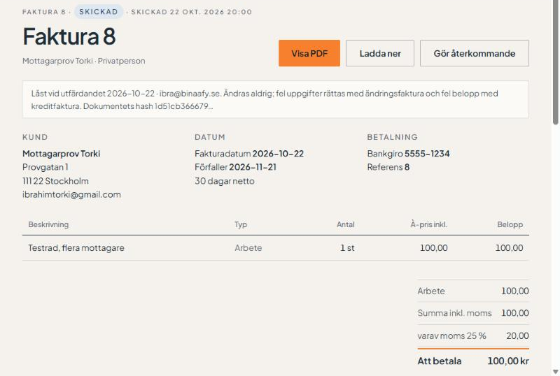

> **Tänk på:** En utfärdad faktura kan aldrig ändras eller tas bort. Det är lagen (bokföringslagen och momslagen), inte en begränsning i systemet. Fel rättas med en ny handling som hänvisar till originalet, se kapitel 9. Granska därför PDF:en noga, särskilt kundens namn, belopp och personnummer.

---

## 6. Skicka

*Syfte: få fakturan till kunden och notera att den är skickad.*

### Mejla fakturan

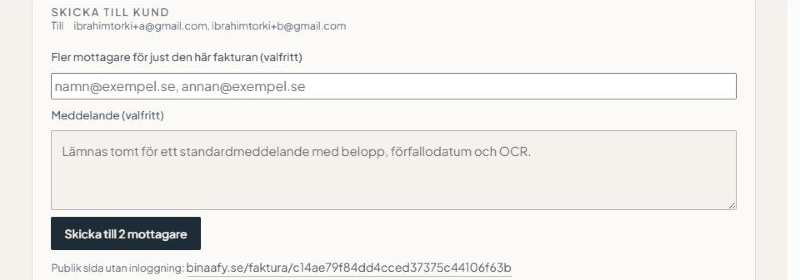

1. Öppna den utfärdade fakturan och gå till rutan **Skicka till kund**.
2. Kontrollera mottagarna på raden *Till* (från kundens Fakturor till och Kopia till).
3. Lägg vid behov till **Fler mottagare för just den här fakturan**.
4. Skriv ett eget **Meddelande** eller lämna tomt för standardtexten med belopp, förfallodag och OCR/referens.
5. Klicka **Skicka till N mottagare**. Mejlet har PDF:en bifogad och en länk till den publika fakturasidan. Fakturan får status **Skickad** och utskicket syns i tidslinjen.

### Markera skickad (post eller annat sätt)

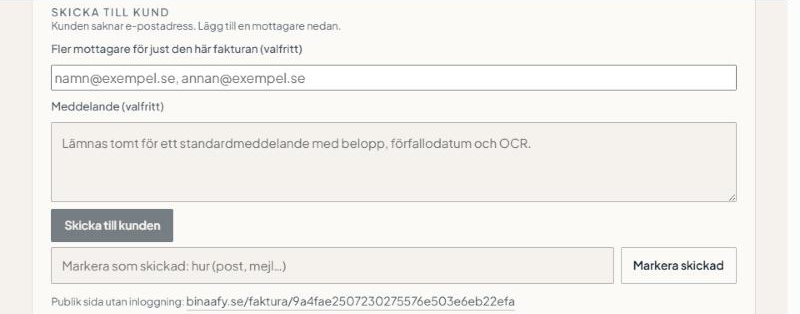

Har kunden ingen e-post, eller lämnade du fakturan på papper: skriv hur i fältet (t.ex. "post" eller "lämnad på plats") och klicka **Markera skickad**. Saknar kunden e-post står det i rutan.

> **Tänk på:** Så fort fakturan är skickad eller markerad skickad går den inte längre att makulera. Rättelser görs då med ändringsfaktura eller kreditfaktura.

### Den publika fakturasidan och Swish-QR

Varje utfärdad faktura har en egen sida utan inloggning, med en lång slumpad adress (*Publik sida utan inloggning* under Skicka-rutan). Kunden ser belopp, förfallodag, hur man betalar och kan visa eller ladda ner PDF:en. Sidan syns inte i sökmotorer.

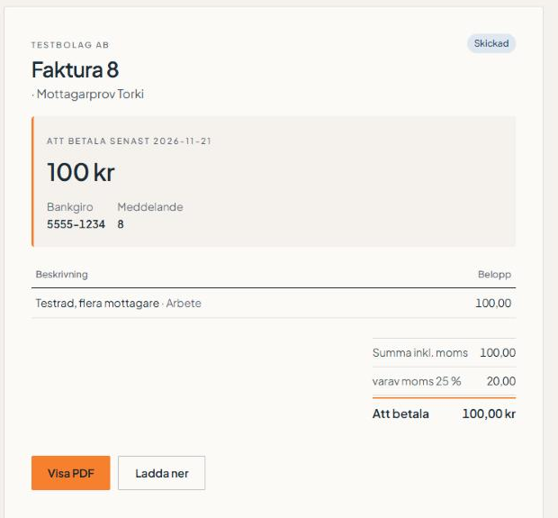

Om ett **Swish-nummer** finns under Inställningar › Betalning visas en **Swish-QR-kod** på PDF:en, i portalen och på den publika sidan. Kunden skannar den i Swish-appen, och belopp och meddelande (OCR eller fakturanummer) fylls i automatiskt. Testbolag AB har inget Swish-nummer, därför syns ingen QR-kod på bilderna.

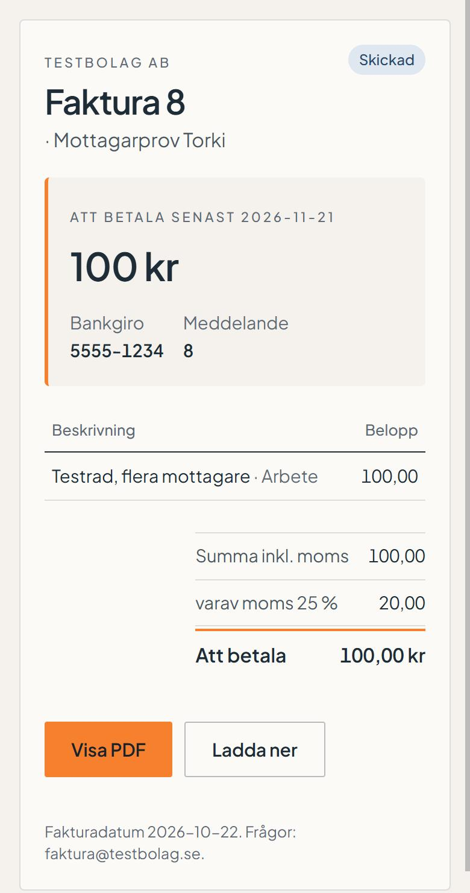

---

## 7. Betalningar

*Syfte: notera när kunden betalat så att fakturan blir Betald och bokföringen stämmer.* Det finns två sätt: för hand, eller genom bankens fil.

### Registrera för hand

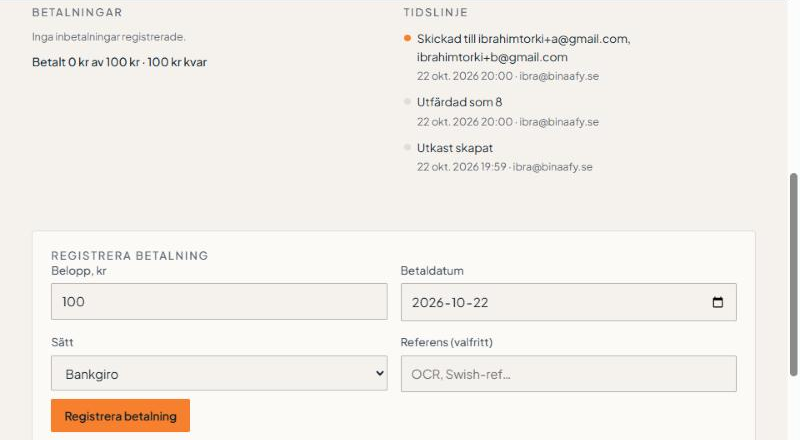

1. Öppna fakturan. Under *Betalningar* står vad som är betalt och vad som är kvar.
2. I rutan **Registrera betalning**: kontrollera **Belopp** (förifyllt med det som är kvar) och **Betaldatum**.
3. Välj **Sätt**: Bankgiro, Swish, Kort eller Annat. Skriv gärna referens (OCR, Swish-referens).
4. Klicka **Registrera betalning**.

**Delbetalning:** skriv det belopp som faktiskt kom in. Fakturan blir *delbetald* och resten står kvar som obetalt. Registrera nästa del när den kommer.

### Bankfilen (camt.054) och matchningen

Banken kan ge en fil med alla inbetalningar till bankgirot (Bankgiro Inbetalningar, formatet ISO 20022 camt.054). Det gamla formatet BgMax slutar Bankgirot skicka efter 27 november 2026.

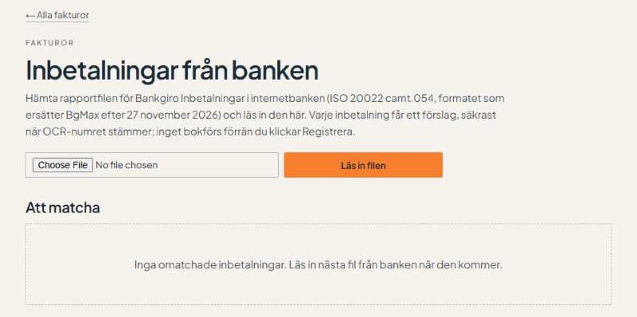

1. Hämta filen i internetbanken (Bankgiro Inbetalningar, camt.054).
2. Gå till **Ekonomi › Bankfil**, välj filen och klicka **Läs in filen**.
3. Under **Att matcha** visas varje inbetalning med datum, avsändare, referens, belopp och ett **förslag**:
   - *OCR stämmer* (säkrast),
   - *Fakturanumret står i meddelandet*,
   - *Belopp och namn stämmer*,
   - *Bara beloppet stämmer* (kontrollera noga).
   Förslaget visar också *delbetalning, X kvar* eller *X för mycket* om beloppet inte stämmer exakt.
4. Kontrollera förslaget, välj annan faktura i listan om det behövs och klicka **Registrera**.
5. Är inbetalningen inte en kundfaktura (t.ex. en återbetalning från leverantör): klicka **Inte en faktura**.

> **Tänk på:** Inget bokförs förrän du klickar **Registrera**. Läs in samma fil bara en gång. Betalningar på en ändringsfaktura registreras alltid på originalfakturan (samma OCR/referens), se kapitel 9.

*Bilden visar sidan utan inlästa poster; i testmiljön fanns ingen bankfil att läsa in.*

---

## 8. Påminnelser och ränta

*Syfte: påminna kunden när en faktura är förfallen och ta ut avgift och ränta enligt lag.*

När en faktura är förfallen och obetald dyker rutan **Påminnelse 1** (2, 3 …) upp på fakturasidan, och fakturan syns under *Förfallna* och på Ekonomi-översikten.

1. Öppna den förfallna fakturan.
2. Läs sammanfattningen i rutan *Påminnelse*: belopp kvar, eventuell avgift och ränta.
3. Välj **Mejla påminnelsen med PDF** (till kundens mottagare) eller **Registrera bara (skickad på annat sätt)**.
4. Klicka **Påminn** och bekräfta. Avgift och ränta bokförs och händelsen syns i tidslinjen.

Regler som systemet följer:

- **Påminnelseavgift 60 kr** tas bara ut från företag, och från privatpersoner bara om det är avtalat och påslaget i Inställningar.
- **Dröjsmålsränta** enligt räntelagen: referensräntan plus 8 procentenheter, räknad från förfallodagen eller från förra påminnelsen.
- Antal dagar före första påminnelsen och mellan påminnelser styrs av Inställningar › Påminnelser.
- Är automatiken påslagen skickar systemet påminnelserna själv varje morgon.

> **Tänk på:** Kontrollera att kunden inte redan betalat (läs in bankfilen först) innan du påminner. En faktura som fått en påminnelse kan inte makuleras.

*Ingen bild: ingen faktura i testmiljön var förfallen, så påminnelserutan gick inte att visa.*

---

## 9. Rätta fel

*Syfte: rätta en utfärdad faktura på det sätt som lagen kräver.* En utfärdad faktura ändras aldrig; varje rättelse blir en ny handling med eget nummer som hänvisar till originalet.

Längst ner på en utfärdad faktura finns rutan **Rätta**:

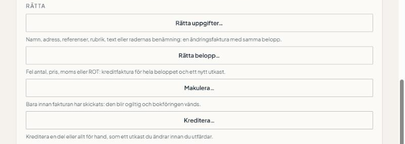

### Beslutstabell

| Situation | Använd | Resultat |
|---|---|---|
| Fakturan är utfärdad men **inte skickad**, ingen betalning eller påminnelse, och den ska inte finnas alls (fel kund, dubbel) | **Makulera…** | Fakturan blir ogiltig men behåller sitt nummer; bokföringen vänds |
| Fel **namn, adress, referens, ordernummer, rubrik, text eller radbenämning**, beloppen stämmer | **Rätta uppgifter…** | En **ändringsfaktura** med nästa nummer, samma belopp, OCR och förfallodag |
| Fel **antal, pris, moms eller ROT**, ingen betalning registrerad | **Rätta belopp…** | En **kreditfaktura** för hela beloppet plus ett **nytt utkast** att rätta och utfärda |
| Kunden ska få **avdrag eller återbetalning** för en del (t.ex. prisavdrag), eller fakturan är redan betald | **Kreditera…** | Ett **kreditfakturautkast** som du ändrar till rätt belopp och utfärdar |
| Fakturan är **skickad** och ska inte gälla alls | **Kreditera…** (hela beloppet) eller **Rätta belopp…** | Kreditfaktura som nollställer |

Knappar som inte går att använda för fakturan visas inte eller förklarar varför.

### Makulera

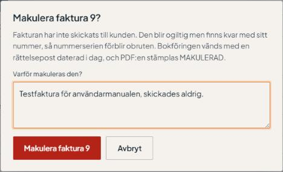

1. Klicka **Makulera…**.
2. Skriv **varför** (t.ex. "Fel kund, fakturerad två gånger"). Orsaken krävs och sparas.
3. Klicka **Makulera faktura N**.

Fakturan får status **Makulerad**, PDF:en stämplas MAKULERAD och en *rättelsepost* daterad i dag vänder bokföringen. Numret finns kvar så att serien är obruten.

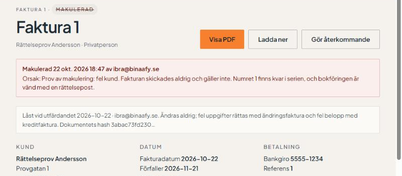

> **Tänk på:** Makulera går bara innan fakturan skickats. Har kunden fått den måste ni kreditera i stället, så att kunden också får en handling som tar bort den.

### Rätta uppgifter (ändringsfaktura)

1. Klicka **Rätta uppgifter…**.
2. Ändra det som är fel: kundens namn och adress, Er referens, Ert ordernummer, Vår referens, rubrik, text eller radernas benämning.
3. Rutan **Texten på ändringsfakturan** visar automatiskt vad som ändrats, t.ex. "Ändringsfaktura. Ersätter faktura 8. Ändrade uppgifter: er referens från (tomt) till 'Anna Torki'."
4. Klicka **Utfärda ändringsfaktura** och skicka den sedan till kunden (kapitel 6).

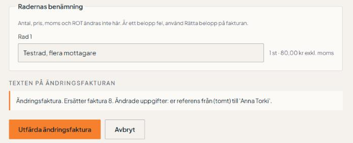

Ändringsfakturan bokförs inte (beloppet är redan bokfört på originalet). Originalet får texten "Rättad genom faktura N".

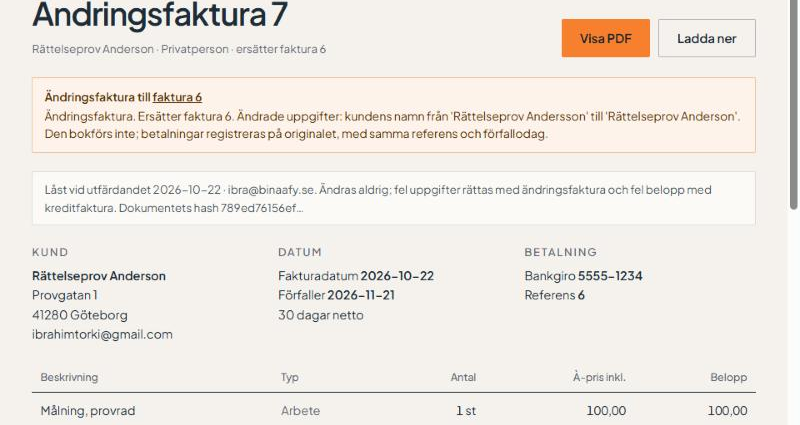

> **Tänk på:** Betalningar registreras alltid på **originalfakturan**, aldrig på ändringsfakturan. Kunden betalar med samma OCR/referens som förut, och bankmatchningen hittar originalet själv.

### Rätta belopp (kredit och ny faktura)

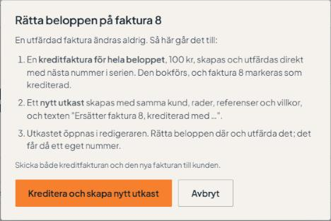

1. Klicka **Rätta belopp…** och läs vad som kommer att hända.
2. Klicka **Kreditera och skapa nytt utkast**.
3. En kreditfaktura för hela beloppet utfärdas direkt, och originalet blir **Krediterad**.
4. Ett nytt utkast öppnas med samma kund, rader och villkor och texten "Ersätter faktura N, krediterad med K.". Rätta beloppen, granska och utfärda.
5. Skicka både kreditfakturan och den nya fakturan till kunden.

> **Tänk på:** Rätta belopp stoppas om fakturan har betalningar; använd då **Kreditera…** för skillnaden. Ligger fakturan i en ROT-begäran som skickats till Skatteverket måste begäran hanteras först.

### Kreditera för hand

**Kreditera…** skapar ett kreditfakturautkast som speglar originalet med minusbelopp. Ändra raderna till det kunden ska få tillbaka (en del eller allt), granska och utfärda. När krediten täcker hela fakturan blir originalet Krediterad.

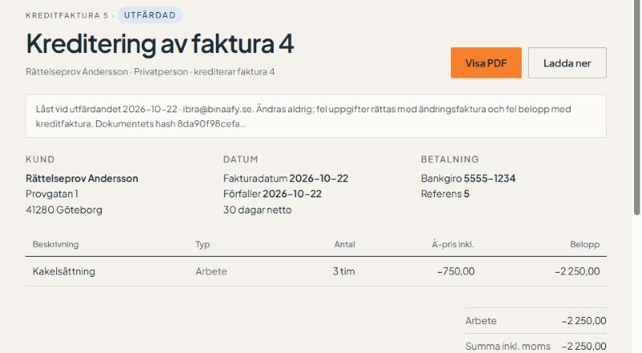

---

## 10. ROT

*Syfte: begära ROT-avdraget från Skatteverket när kunden betalat sin del, och registrera utbetalningen.* Sköts normalt av ägaren. Sidan heter **Ekonomi › ROT och RUT**.

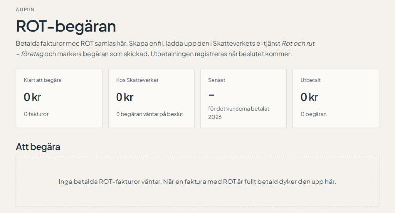

Översikten visar fyra tal: **Klart att begära**, **Hos Skatteverket**, **Senast** (sista dag att begära för det som betalats i år, 31 januari året efter) och **Utbetalt**.

1. När en ROT-faktura är **fullt betald** dyker den upp under **Att begära**, märkt *Komplett* eller med det som saknas.
2. Ge begäran ett **namn** (högst 16 tecken, t.ex. "ROT 2610") och välj **typ av arbete** (Bygg, El, VVS …).
3. Klicka **Skapa begäran (N fakturor, X kr)**. Ofullständiga fakturor lämnas utanför.
4. Under *Pågående begäran*: **1. Ladda ner XML-filen**.
5. **2.** Logga in i Skatteverkets e-tjänst *Rot och rut – företag*, ladda upp filen och signera.
6. **3. Markera som skickad**.
7. När Skatteverket betalat ut: skriv **Utbetalt, kr** och **Datum** och klicka **Registrera utbetalning**. Beloppet bokförs mot ROT-fordran.
8. Avslår Skatteverket: skriv motiveringen och klicka **Markera avvisad**. Kunden ska då betala den del som inte godkändes; skicka en ny faktura för den.

> **Tänk på:** Delbetalda fakturor kommer inte med förrän allt är betalt. Begär senast 31 januari året efter att kunden betalade. Personnumren i filen är kompletta (tolv siffror) men visas aldrig i klartext i listorna.

*Bilden visar sidan utan väntande begäran; i testmiljön fanns ingen betald ROT-faktura.*

---

## 11. Återkommande fakturor

*Syfte: fakturera avtal som återkommer varje månad, kvartal eller år utan att skriva om fakturan.* Sidan heter **Ekonomi › Återkommande fakturor**; du kan också klicka **Gör återkommande** på en faktura.

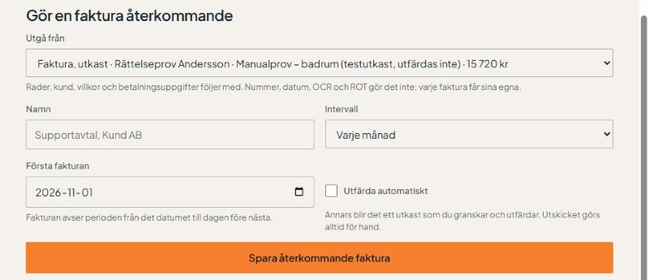

1. Under *Gör en faktura återkommande*, välj vilken faktura den ska **utgå från**. Rader, kund, villkor och betalningsuppgifter följer med; nummer, datum, OCR och ROT gör det inte.
2. Ge avtalet ett **namn** (t.ex. "Serviceavtal, Kund AB").
3. Välj **intervall**: varje månad, kvartal eller år.
4. Välj datum för **första fakturan**. Fakturan avser perioden från det datumet till dagen före nästa.
5. Bocka i **Utfärda automatiskt** om fakturan ska utfärdas direkt; annars blir det ett utkast som du granskar.
6. Klicka **Spara återkommande faktura**.

Varje morgon skapar systemet de fakturor som ska ut. Översikten visar aktiva avtal, belopp per månad och vad som skapas i dag. Avtal kan pausas och tas bort; för att ändra ett avtal, ta bort det och gör ett nytt från en uppdaterad faktura.

> **Tänk på:** Utskicket görs alltid för hand, även när fakturan utfärdas automatiskt. Titta på *Utkast* och *Obetalda* varje månad.

---

## 12. Byggprojekt och betalplaner

*Syfte: fakturera ett större jobb i delar och följa projektets ekonomi.* Projekten finns under **Projekt**.

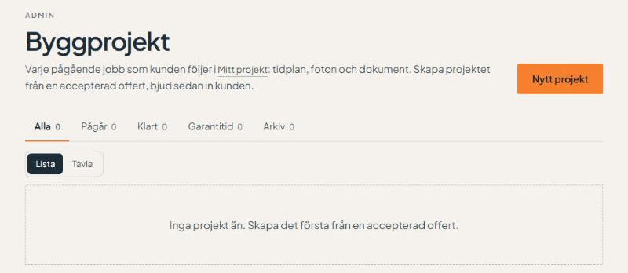

1. Skapa projektet från en **accepterad offert** (**Nytt projekt** eller från offerten) och bjud in kunden till portalen.
2. På projektsidan finns rutan **Ekonomi**: offert, godkända ÄTA (ändrings- och tilläggsarbeten), fakturerat, betalt och kvar.
3. Under **Betalplan**, välj en mall och klicka **Använd planen**:
   - **30 / 40 / 30**: 30 % vid start, 40 % när en vald fas är klar, resten vid klart projekt.
   - **50 / 50**: hälften vid start, resten vid klart projekt.
   - **Allt vid klart**: en faktura när projektet är klart, inklusive ÄTA.
4. Varje steg visar procent, när det faktureras och ungefärligt belopp. När steget kan faktureras (fasen är bockad klar eller datumet har kommit) visas knappen **Skapa faktura**. Annars står skälet.
5. **Skapa faktura** öppnar ett utkast med stegets rader, fördelade på arbete och material så att ROT blir rätt. Granska och utfärda som vanligt.
6. **Slutfakturan** tar resten av offerten plus alla godkända ÄTA som egna rader.

**Kostnader och marginal:** under projektets ekonomi kan ni lägga in kostnader (leverantörsfaktura, material, timmar med internt timpris). Projektet visar då täckningsbidrag, marginal och *upparbetat men ej fakturerat*. Kostnaderna är interna siffror och syns inte för kunden eller i bokföringsexporten.

**Projektrapporten** (dokumentationen med foton som kunden får när projektet är klart) nås från projektsidan och är inte en del av faktureringen.

> **Tänk på:** Inget faktureras av sig självt. Knappen *Skapa faktura* visas också på Ekonomi-översiktens *Att göra*, men någon måste trycka och utfärda.

*Bilden visar projektlistan utan projekt; i testmiljön fanns inget projekt med betalplan.*

---

## 13. Ekonomi och bokföring

*Syfte: se hur det går, och lämna bokföringen till redovisningskonsulten.*

### Översikten

**Ekonomi › Översikt** räknas fram ur fakturor, betalningar och betalplaner. Ingenting skrivs in här.

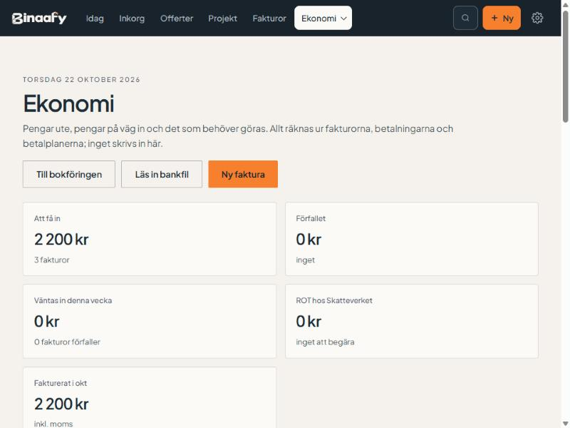

| Ruta | Betyder |
|---|---|
| Att få in | Allt som är utfärdat och inte betalt |
| Förfallet | Det av ovan där förfallodagen har passerat |
| Väntas in denna vecka | Förfaller inom veckan |
| ROT hos Skatteverket | Begärt men inte utbetalt |
| Fakturerat i månaden | Utfärdat i månaden, inklusive moms |

Längre ner: **Kassaprognos 8 veckor** (förfallodagar och planerade steg i betalplaner), **Obetalt per ålder**, snitt dagar till betalning, **Att göra**, fakturerat per månad, utgående moms, största obetalda kunder och senaste händelser.

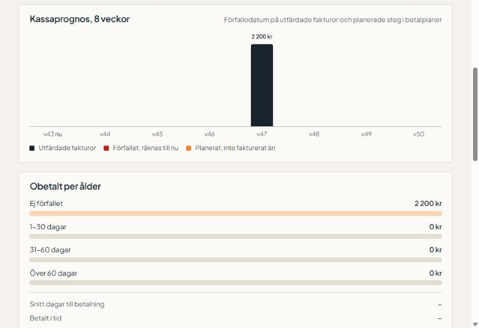

### SIE-export för bokföringen

Varje faktura, betalning och påminnelse har redan en verifikation. Sidan **Ekonomi › Export och bokföring** samlar dem per månad.

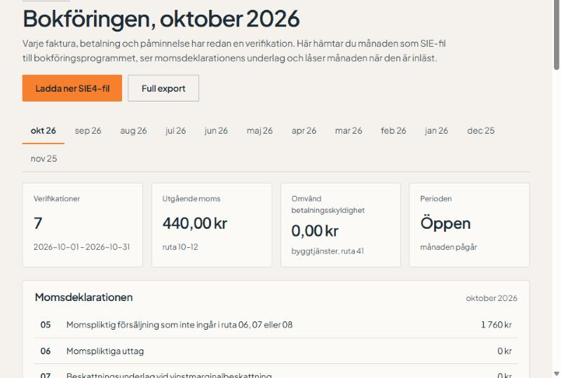

1. Välj månad i raden av flikar (okt 26, sep 26 …).
2. Kontrollera antal verifikationer, utgående moms och omvänd moms.
3. Klicka **Ladda ner SIE4-fil** och läs in den i bokföringsprogrammet (Fortnox, Visma m.fl.).
4. Underlaget till **momsdeklarationen** (ruta 05–12, 41, 42) visas på sidan. Inköp och ingående moms (ruta 48) kommer från bokföringen.

### Periodlåsning

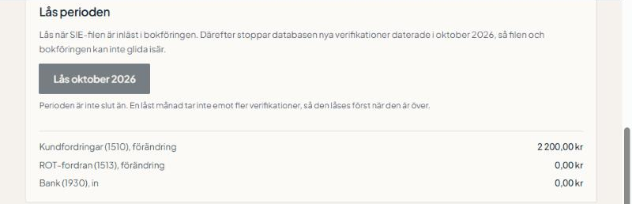

När SIE-filen är inläst i bokföringen: klicka **Lås [månad]**. Därefter tar systemet inte emot nya verifikationer daterade den månaden, så filen och bokföringen kan inte glida isär. Bara månader som är slut kan låsas.

> **Tänk på:** Lås inte förrän redovisningskonsulten bekräftat att filen är inläst. En låst månad kan inte ta emot rättelser; de bokförs i stället i den öppna perioden.

### Full export

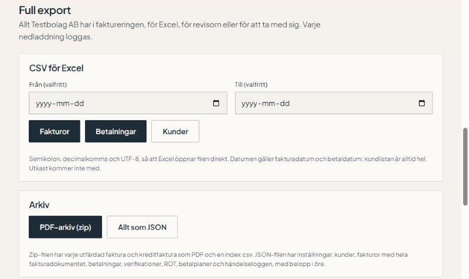

För revisorn, för Excel eller för att ta med sig allt:

- **CSV för Excel**: *Fakturor*, *Betalningar* eller *Kunder*, med valfritt datumintervall. Öppnas direkt i svensk Excel. Utkast kommer inte med.
- **PDF-arkiv (zip)**: varje utfärdad faktura och kreditfaktura som PDF, plus en innehållsförteckning (index.csv).
- **Allt som JSON**: inställningar, kunder, fakturor, betalningar, verifikationer, ROT, betalplaner och händelseloggen. Ägare och administratörer får personnummer i klartext, övriga maskerade.

Varje nedladdning loggas med vem som gjorde den.

---

## 14. Organisation och API

*Syfte: bjuda in kollegor och revisor, och koppla andra system.* Sköts av ägaren eller en administratör.

### Bjuda in

1. Kugghjulet › **Organisation och roller**.
2. Under **Bjud in**: skriv e-postadressen, välj roll (se kapitel 1) och klicka **Bjud in**.
3. Den inbjudna får en länk som gäller i 14 dagar och loggar in med samma e-postadress. Om mejl inte är påslaget visas länken på sidan så att du kan skicka den själv.
4. En inbjudan som inte används kan **dras tillbaka**.

Längst ner finns **Skapa en ny organisation**, för ett nytt företag med egna serier och inställningar.

### API och webhooks

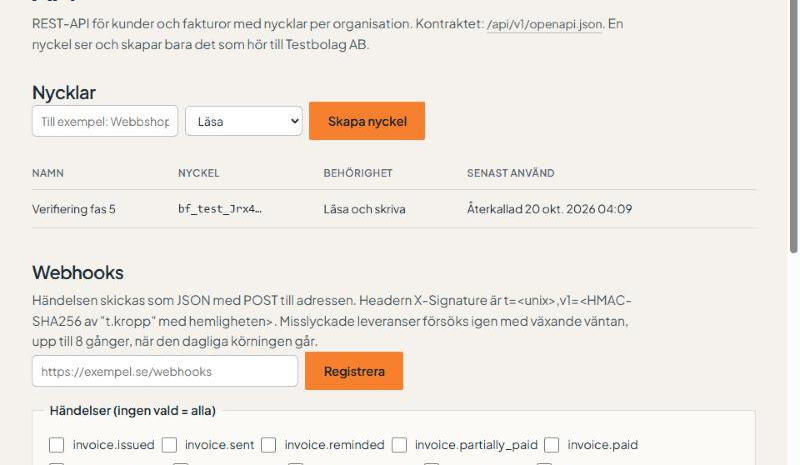

För utvecklare som vill koppla t.ex. en webbshop: under **API** skapas nycklar (*Läsa* eller *Läsa och skriva*) som bara ser det egna företagets kunder och fakturor. **Webhooks** skickar ett meddelande till en annan adress när något händer (faktura utfärdad, betald, påminnelse …). Nyckeln visas bara en gång när den skapas; spara den på ett säkert ställe och återkalla den när den inte behövs.

---

## 15. Kundportalen och kundens vy

*Syfte: veta vad kunden ser, så att du kan svara på frågor.*

**Den publika fakturasidan** (kapitel 6) är det kunden alltid når via länken i mejlet, utan inloggning: belopp, förfallodag, bankgiro och OCR/referens, Swish-QR om Swish-nummer finns, raderna och PDF:en.

**Kundportalen** (*Mitt projekt*, binaafy.se/mitt-projekt) är för kunder med ett byggprojekt. Kunden loggar in med sin e-post och ser fliken **Fakturor** med:

- varje faktura med belopp, förfallodag och status (märke för obetalda),
- PDF:en, Swish-QR, bankgiro och OCR/referens,
- vid ROT: arbete och material inklusive moms, ROT-avdraget och texten "ROT-avdraget begär vi hos Skatteverket när du har betalat. Du behöver inte göra något."
- en tidslinje utan interna anteckningar.

Kostnader, marginal och interna anteckningar syns aldrig för kunden.

*Ingen bild av portalen: din inloggning hör inte till något kundprojekt, och i testmiljön fanns inget projekt med kund. Bilderna av den publika fakturasidan visar samma uppgifter som portalens faktura.*

---

## 16. Vanliga frågor

**Jag utfärdade en faktura med fel uppgift. Kan jag ändra den?**
Nej, aldrig. Se beslutstabellen i kapitel 9: makulera om den inte skickats, annars ändringsfaktura (fel uppgift) eller kreditfaktura (fel belopp).

**Varför har fakturan "Referens" och inget OCR-nummer?**
Bankgirot har inget OCR-avtal (Inställningar › Betalning). Kunden skriver då fakturanumret som meddelande. Det fungerar lika bra för matchningen.

**Kunden betalade fel belopp.**
Registrera det som faktiskt kom in. För lite: fakturan blir delbetald och resten står kvar. För mycket: kontakta kunden och betala tillbaka, eller kreditera om det är avtalat.

**Kunden betalade på ändringsfakturan.**
Registrera betalningen på originalfakturan. Systemet stoppar betalning på en ändringsfaktura.

**Varför kan jag inte trycka på Makulera?**
Fakturan är redan skickad, har en betalning, påminnelse, ändringsfaktura eller ROT-begäran. Använd Kreditera eller Rätta belopp.

**Kan jag ta bort ett utkast?**
Ja, med **Ta bort utkastet**. Utkast har inget nummer. Utfärdade fakturor kan aldrig tas bort.

**Fakturanumren hoppar, saknas nummer?**
Nej. Serien F är obruten. Makulerade fakturor och kreditfakturor behåller sina nummer och syns under fliken Krediterade/makulerade.

**Kunden fick inte mejlet.**
Kontrollera mottagarna i Skicka-rutan och kundens *Fakturor till*. Skicka igen, eller skicka länken till den publika sidan via sms.

**Vad betyder statusarna?**
*Utkast* (kan ändras), *Utfärdad* (låst, inte skickad), *Skickad*, *Delbetald*, *Betald*, *Förfallen*, *Krediterad*, *Makulerad*.

**Jag ser inte Inställningar eller Bokföringen.**
Din roll ger inte åtkomst. Be ägaren ändra din roll under Organisation och roller.

**Revisorn vill ha allt för året.**
Bjud in revisorn som *Redovisningskonsult*. Hen kan själv ladda ner SIE-filer per månad, CSV och PDF-arkivet under Export och bokföring.

**ROT-begäran avvisades.**
Markera den avvisad på ROT-sidan med Skatteverkets motivering, och fakturera kunden för den del som inte godkändes.
